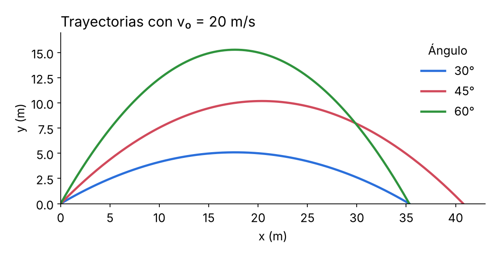
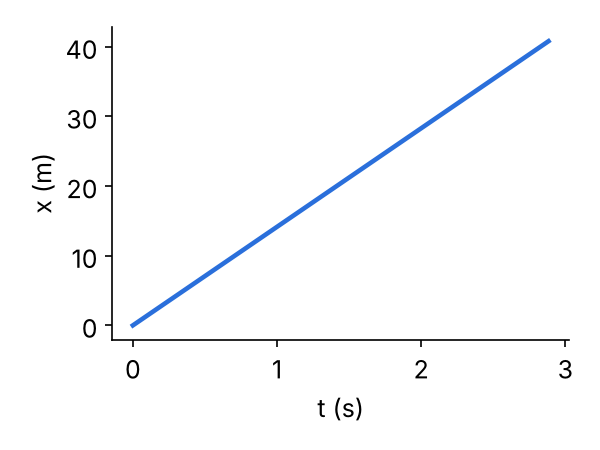
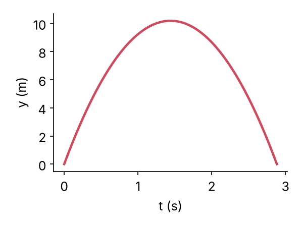

Una imagen es un fichero (PNG, JPG, GIF, SVG…) que MyST coloca en la página. Las de este proyecto están en la carpeta `imagenes/img/`, y las rutas se escriben **relativas a la página** que las usa.

## Imagen sencilla

La forma más rápida es la sintaxis de Markdown: un signo de exclamación, el texto alternativo entre corchetes y la ruta entre paréntesis.

```markdown

```

Resultado:


El **texto alternativo** describe la imagen para quien no puede verla (lectores de pantalla) y se muestra si el fichero no carga. Conviene escribirlo siempre.

## Imagen con opciones

La directiva `image` permite fijar el tamaño y la alineación:

```markdown
:::{image} img/componentes.svg
:alt: Descomposición de la velocidad inicial en sus componentes
:width: 300px
:align: center
:::
```

Resultado:

:::{image} img/componentes.svg
:alt: Descomposición de la velocidad inicial en sus componentes
:width: 300px
:align: center
:::

`:width:` admite píxeles (`300px`) o un porcentaje del ancho de la columna (`50%`). `:align:` admite `left`, `center` o `right`.

## Figuras: imagen con pie, número y etiqueta

Una **figura** es una imagen con pie. MyST la numera automáticamente y, si lleva etiqueta (`:label:`), se puede citar desde cualquier página.

```markdown
:::{figure} img/trayectorias.png
:label: fig-trayectorias
:alt: Tres trayectorias parabólicas para ángulos de 30, 45 y 60 grados
:width: 90%

Trayectorias de un proyectil lanzado a 20 m/s con tres ángulos distintos. Con 45° se alcanza la mayor distancia; 30° y 60° llegan al mismo punto.
:::
```

Resultado:

:::{figure} img/trayectorias.png
:label: fig-trayectorias
:alt: Tres trayectorias parabólicas para ángulos de 30, 45 y 60 grados
:width: 90%

Trayectorias de un proyectil lanzado a 20 m/s con tres ángulos distintos. Con 45° se alcanza la mayor distancia; 30° y 60° llegan al mismo punto.
:::

Ahora se puede citar escribiendo `[](#fig-trayectorias)`, y MyST pone el texto del enlace: [](#fig-trayectorias). Pasa el ratón por encima: aparece la figura completa en una ventana emergente.

:::{figure} img/componentes.svg
:label: fig-componentes
:alt: La velocidad inicial como suma de una componente horizontal y otra vertical
:width: 320px

La velocidad inicial $\vo$ se descompone en una componente horizontal, $v_x$, y otra vertical, $v_y$.
:::

Esta segunda figura, [](#fig-componentes), es un SVG: un formato vectorial que se ve nítido a cualquier tamaño. Es el formato recomendable para esquemas y dibujos. Una advertencia: para el PDF con LaTeX, MyST tiene que convertir los SVG, y para ello pide tener instalado Inkscape. Typst los usa directamente.

## Subfiguras

Una figura puede contener varias imágenes. Cada una lleva su etiqueta en la línea anterior, con la forma `(etiqueta)=`, y su texto alternativo hace de subtítulo. La opción `:class: grid grid-cols-2 gap-4` las coloca en dos columnas: son clases de estilo del tema web, que el PDF ignora.

```markdown
:::{figure}
:label: fig-posicion
:class: grid grid-cols-2 gap-4

(fig-posicion-x)=


(fig-posicion-y)=


Las dos coordenadas del proyectil lanzado a 45°, en función del tiempo.
:::
```

Resultado:

:::{figure}
:label: fig-posicion
:class: grid grid-cols-2 gap-4

(fig-posicion-x)=


(fig-posicion-y)=


Las dos coordenadas del proyectil lanzado a 45°, en función del tiempo.
:::

Se puede citar la figura entera, [](#fig-posicion), o cada parte por separado: [](#fig-posicion-x) y [](#fig-posicion-y).

:::{warning} Subfiguras y PDF
Al exportar a PDF, Typst compone bien las subfiguras. Con LaTeX, en cambio, MyST 1.13 genera un documento que da errores de composición en este punto, y las subfiguras se pierden. Si un material con subfiguras se va a imprimir, conviene usar Typst.
:::

:::{tip} Para explorar más
- Todas las opciones de imágenes y figuras: <https://mystmd.org/guide/figures>.
- Una imagen también puede estar en internet: basta con poner su dirección completa (`https://…`) en lugar de la ruta. Si la imagen desaparece de ese sitio, desaparece también de tu material.
:::
